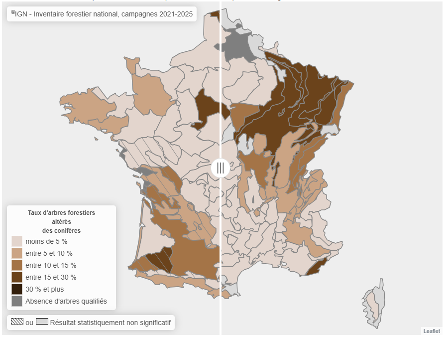
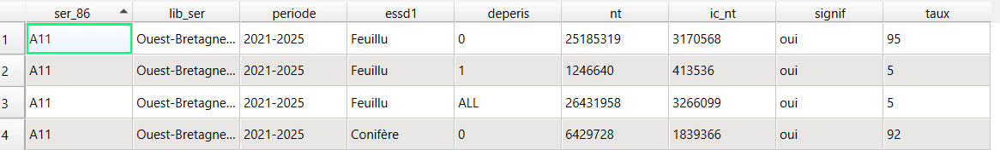
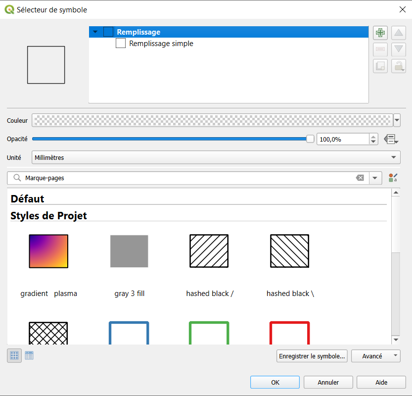
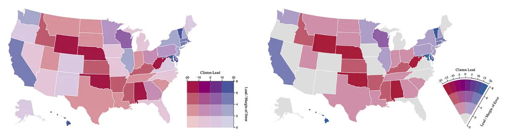
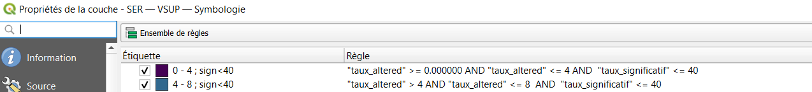
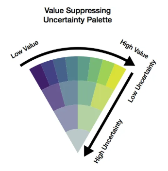
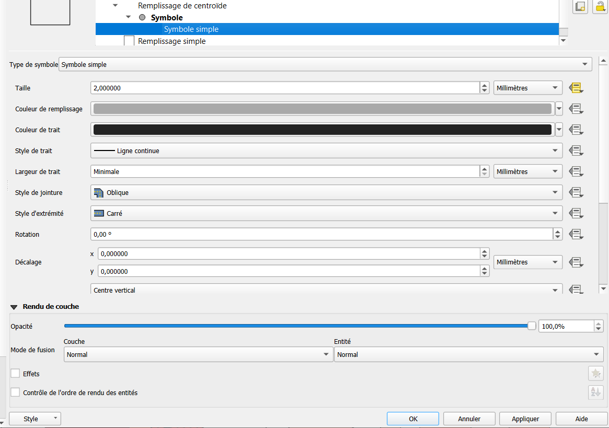
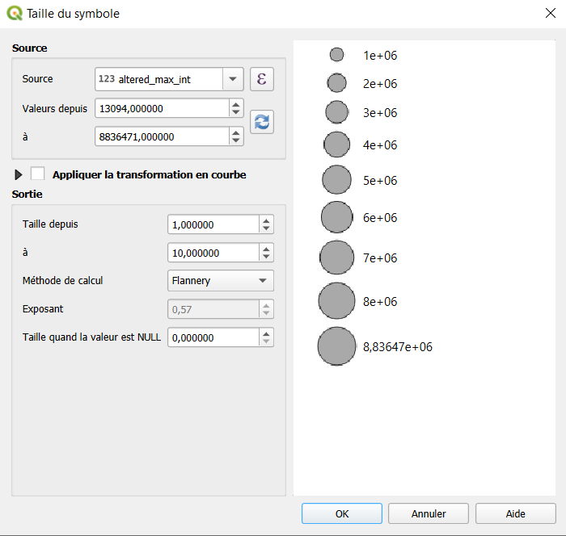

# FIRS - DATA ANALYSIS AND STORYTELLING

## Visualizing uncertainty

*QGIS*

In this exercise, you will create visualizations of weathered/altered trees rate (*taux d'arbres altérés*) by sylvoecoregions, using datasets produced by the *Inventaire Forestier*. 

This [example](https://inventif.ign.fr/sante/?tab=deper_ess) shows a way to represent this data: a sequential color palette represents the weathered/altered trees rate, while statisticaly non-significant data are represented, either by a grey color, or by hatching overlaid on the color palette.
- The first option highlights the lack of significant data, but hides the value for the rate of altered trees, potentially creating the impression that no data exists for the area in question.
- The second option allows for the simultaneous visualization of information regarding the rate of altered trees and data significance, but it adds a degree of complexity to the map.
In both options, the uncertainty regarding the data is considered as a boolean value: the value is statisticaly significant, or not.

*Source: https://inventif.ign.fr/*

The represented data are outputs of statistical models produced and used by the *Inventaire Forestier*. For each sylvoecoregion, and for each tree specie, these models produce an estimation of the number of tree stems, altered or not, with a confidence interval. A number of tree stems is considered as significant when the confidence interval is less than 80% of the total number of stems. 

The following table is an image of the dataset.
- the 3 lines correspond to a triplet ecoregions (*ser_86* and *lib_ser*)-campaign or campaings grouping (*campagne*)-tree species or tree species grouping (*essd1*).
- the column *deperis* indicates if the line corresponds to sane tree stems (*deperis=0*), altered tree stems (*deperis=1*), or all tree stems either sane or altered (*deperis=ALL*).
- the column *nt* indicates the number of estimated tree stems.
- the column *ic_nt* indicates the value of the confidence interval.
- the column *signif* indicates either if *nt* is significant or not, meaning that *ic_nt*/*nt* is inferior to 0.8.
- the column *taux* indicates the proportion of the corresponding tree stems (altered or not) on the overall number of tree stems. For the line representing the total number of tree stems (*deperis=ALL*), the column *taux* indicates the proportion of altered trees on the overall number of tree stems.

*Source: Inventaire Forestier, IGN*

The rate of altered trees is then calculated as the ratio of the number of affected stems to the total number of stems. 
So *nt* (for *deperis=1*) / ( *nt* (for *deperis=0*) + *nt* (for *deperis=1*) )
The *Inventaire Forestier* is considered as significant if the estimated total number of tree stems is considered as significant.
So if *ic_nt* (for *deperis=ALL*) /*nt* (for *deperis=ALL*) is inferior to 0.8.

The data is available [here](data/deperis_SER_data_1_5.csv).
The geographic contours of the sylvoecoregions is available [here](data/SER_contours.gpkg).

This exercise has two objectives:
- to make you discover different ways to map information using QGIS.
- show you different ways to co-visualize uncertainty, in others ways that as a boolean information.

## Exercise 6

### Treating uncertainty as a boolean value. Univariate color scale and pattern change. 

1. From the downloaded dataset, extract the corresponding information in order to represent the rate of altered trees for the conifers, and join these data to the geographic contours of the sylvoecoregions. 
2. Using the symbology menu of QGIS, create a choropleth map representing the rate of altered trees for the conifers. Create the necessary columns in order to represent the information as a quantitative information. Use a pertinent discretisation method according to the data distribution.
3. Create a map similar to the [InventIF one](https://inventif.ign.fr/sante/?tab=deper_ess), by using hatching to represent if the data is significant or not. Use a second layer overlaid on your first layer, and explore the "symbol selector" menu to create the hatching.

*Which visual channels are you using to represent the information?*

### Treating uncertainty as a quantitative indicator. Bivariate color scale. 

4. We consider now the ratio of the confidence interval by the total number of stems as an uncertainty indicator. Calculate this new indicator.
5. Using a bivariate color scale, represent by color simultaneously the rate of altered trees and our new uncertainty indicator. Use this [example](https://bnhr.xyz/2019/09/15/bivariate-choropleths-in-qgis.html). Create one layer, representing each one information with a different color scale. Use pertinent discretisation methods according to the data distribution. Change finally the blending method of the top layer.
6. Using the *Bivariate Legend plugin*, create a color legend for your map.
7. **Going further:** Create a map using the layout menu. Add the map scale, title, orientation, the data source, and the legend. 

*What do you think of this map?*

### Highlight certain data and minimize uncertain data

In the next session, we will use an approach proposed by Correll, Moritz and Heer in 2018 and called *Value Suppressing Color Palette (VSUP)*.
The concept behind this approach (which employs bivariate color scales to represent both a value and an uncertainty indicator) is to vary the number of value classes displayed based on the uncertainty indicator value.

*Source: [Correll and al., 2018](https://medium.com/@uwdata/value-suppressing-uncertainty-palettes-426130122ce9)*

QGIS does not have yet a plugin for creating VSUP color scales. Such scales can be created using JavaScript libraries based on D3, or via Python modules. 
For this exercice, we will take a shortcut by using the rule-based editor found in the QGIS symbology menu.

The rule-based editor allows to specify a specific symbol to represent a series of features, defined by an SQL condition.
We will use it to define a series of features corresponding to the various color categories in the VSUP legend below, and then assign to each entity a symbol bearing the corresponding color code.

*Source: [Correll and al., 2018](https://medium.com/@uwdata/value-suppressing-uncertainty-palettes-426130122ce9)*

8. Using the rule-based editor and the following color codes to represent the data using a VSUP color scale.
- Uncertainty level 1
#3f1f69
#434184
#46628b
#50808d
#5e9c89
#77b877
#a0d156
#dbe039
- Uncertainty level 2
#685891
#6e8b9f
#84b798
#c7db6d
- Uncertainty level 3
#9094b2
#b4d2a3
- Uncertainty level 4
#bbc9c9

### Represent uncertainty on quantitative data

We will now directly represent the number of altered stems as a quantitative data, and co-visualize it with the confidence interval.

9. From the original dataset, extract the corresponding information in order to represent the absolute number of altered trees for the conifers, and join these data to the geographic contours of the sylvoecoregions. Create the necessary columns in order to represent the information as a quantitative information.
10. Create a proportional symbol map to represent the absolute number of altered trees for the conifers. In order to do that, use the "symbol selector" menu to specify that you want to represent each polygonal feature through a punctual symbol located at its centroid (see figures below). Then, in the same menu, modify the size of the symbol according to the number of the number of altered tree stems.

**Never** *use the graduated symbol option from the symbology menu to create a proportional symbol map. Because this option is based on a discretisation of the represented values, you obtain symbols of with a defined set of different sizes representing value intervals, instead of having symbols whose size directly represents the value.*

11. Using the same method, create a second proportional symbol overlaid on the first, representing the possible maximum of altered stems according to the confidence interval. Be carefull of the values you use for defining the graphic scale of your symbols, in order have the same for the two series of proportionnal symbols. 

